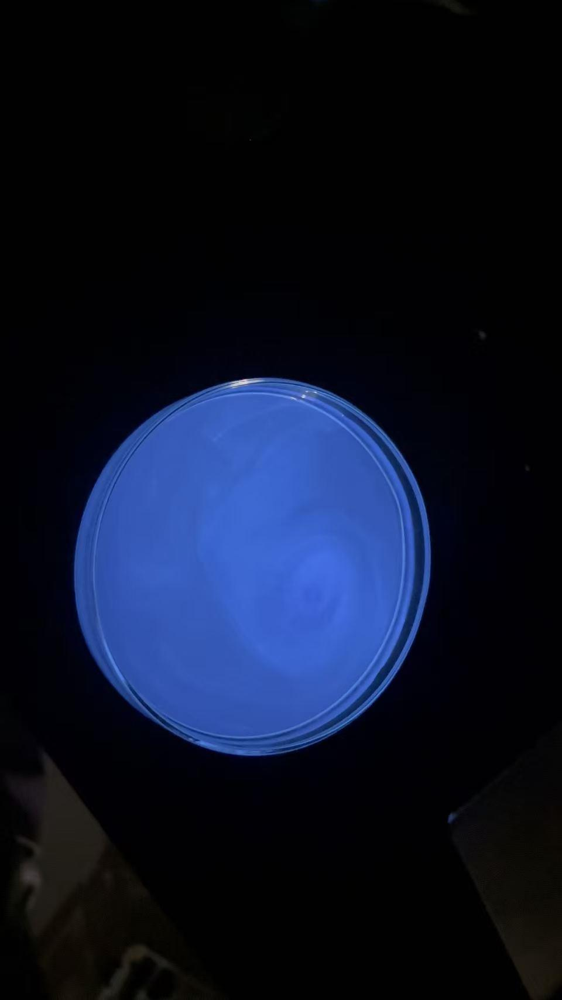
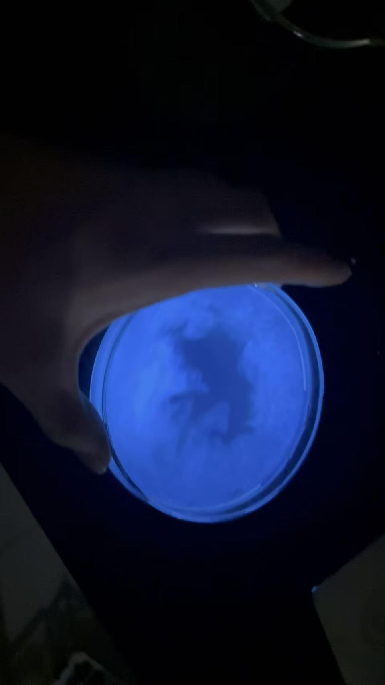
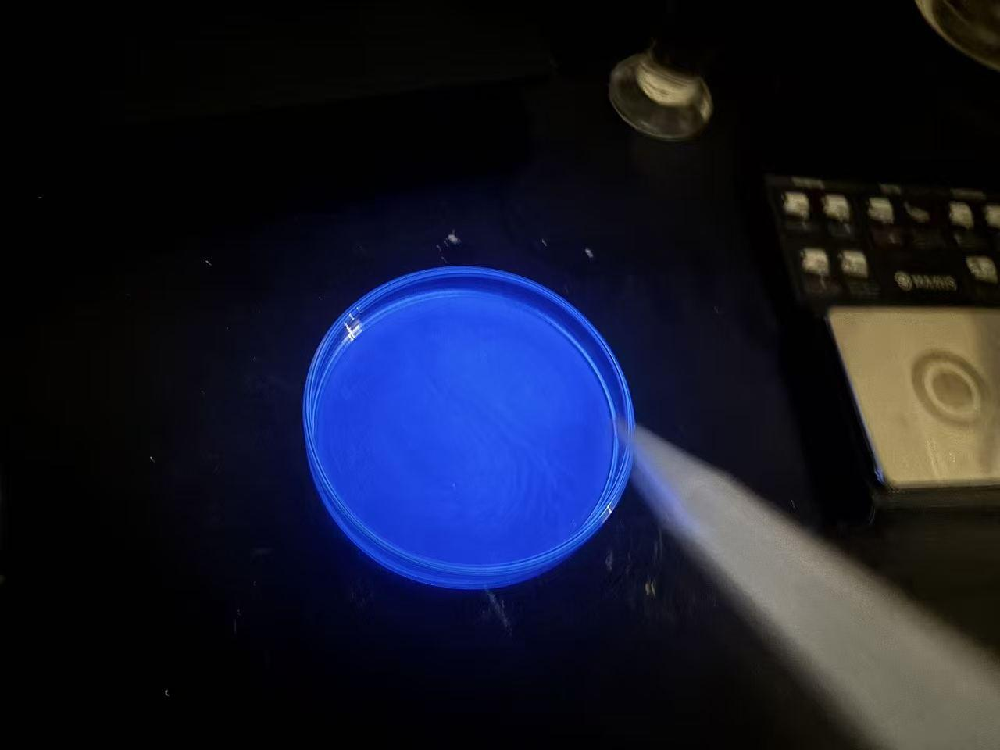

# Chemiluminescence of Luminol

[Original PDF](report.pdf) · [All experiments](../)

*Original experiment report, reformatted for reading on GitHub.*

## Purpose

To observe the light produced by the oxidation reaction of luminol and study and explain its chemical properties and reactions.

## Materials

| Chemical | Quantity |
| --- | --- |
| Luminol | 0.010 g |
| Anhydrous sodium carbonate, Na₂CO₃ | 0.20 g |
| Sodium bicarbonate, NaHCO₃ | 1.20 g |
| Commercial ammonium carbonate / Baker's ammonia | 0.025 g |
| Copper(II) sulfate pentahydrate, CuSO₄·5H₂O | 0.020 g |
| 3% hydrogen peroxide, H₂O₂ | 2.5 mL |
| Distilled water | To prepare 50 mL of each solution |

## Procedure

1. 30ml of distilled water was used to dissolve the sodium carbonate.
2. Luminol added with sodium bicarbonate, ammonium carbonate and copper sulfate.
3. 2.5 ml of 3% hydrogen peroxide was diluted with water to value of 50ml
4. Mixing them together.

## Observations

- A bright blue light was visible in the container

## Chemical explanation

- The main reason for generating light during the reaction is that the excited product releases energy in the form of light once it returns to the ground state.
- The carbonate solution provides the alkaline condition in which luminol loses protons and forms a dianion. In the reaction, hydrogen peroxide acts as the oxidizing agent, and copper helps the reaction proceed faster.
- The oxidation involves peroxide intermediates that experience bond rearrangements, releasing nitrogen gas and producing 3- aminophthalate, and the energy comes from electronic excitation.
- This glow will weaken once the energy is all released; it is irreversible because the structure of the luminol has changed, with no reverse electron transfer.

---

[View the original PDF](report.pdf) · [Back to all experiments](../)
