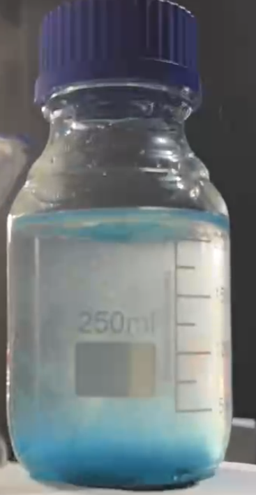
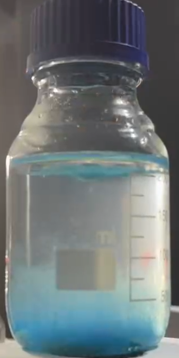

# Chemical Garden

[Original PDF](report.pdf) · [All experiments](../)

*Original experiment report, reformatted for reading on GitHub.*

## Purpose

To observe the growth of the chemical garden and explain chemical reactions such as osmosis and liquid flow.

## Materials

| Chemical or equipment | Quantity recorded |
| --- | --- |
| Copper(II) sulfate pentahydrate, CuSO₄·5H₂O | Small crystals |
| Sodium silicate solution | 40% stock solution; dilution and volume |
| Distilled water | — |
| Clear beaker or test tube | 1 |
| Laboratory spoon | 1 |

## Procedure

1. Add 150 mL of distilled water
2. Add 50 mL of 40% sodium silicate solution, ratio 1: 3.
3. Wait for 5 minutes until there are no bubbles.
4. Add 20 g of copper sulfate powder on the surface.
5. Wait for 30 minutes
6. The recorded video shows the slow growth

## Observations

The blue “cloud” formed at the beginning, then dropped to the bottom. After 5 minutes, some tubes slowly grew from the crystal and bent with other branches at the middle parts,

## Chemical explanation

- Copper sulfate dissolved and reacted with the water glass. Formed a thin membrane layer.
- Water enters the membrane by osmosis, which increases the pressure inside.
- This pressure breaks the membrane, which allows the copper liquid to flow out of the membrane.
- Cu²⁺ + 2OH⁻ → Cu(OH)₂
- The liquid flows out of the membrane and reacts with the solution to build the hollow tubes
- It is vulnerable to mixing or shifting of the glass because the flow of liquid makes the chemical reaction that bends the tubes together.

## Experiment video

- [Watch the experiment](https://jw3422951-ops.github.io/chemistry-portfolio/#experiment-02-video-01) · [Download original](assets/video-01.mp4)

The playback page includes video controls and fullscreen viewing.

---

[View the original PDF](report.pdf) · [Back to all experiments](../)
