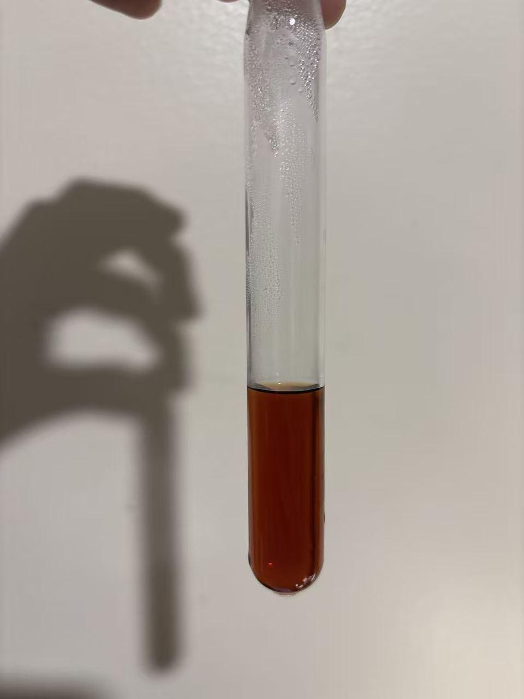
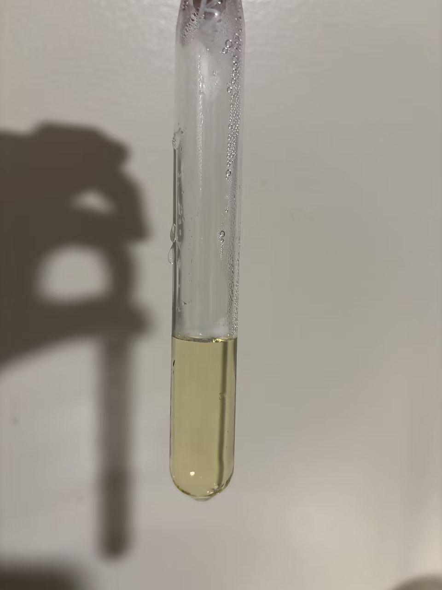
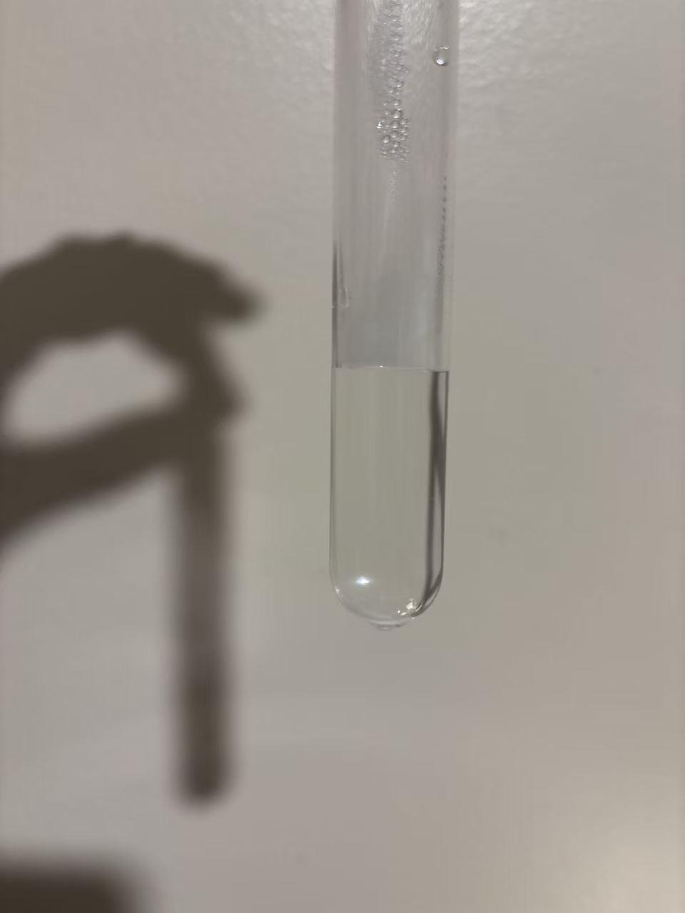
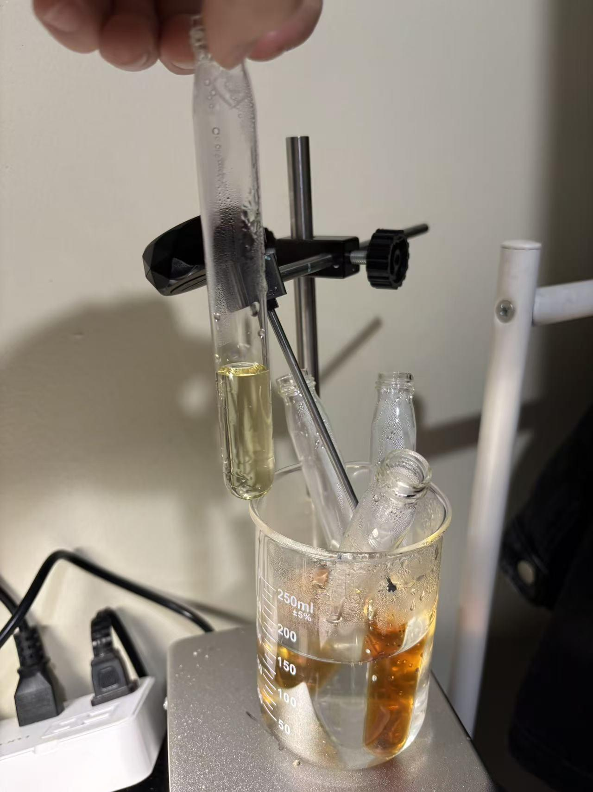
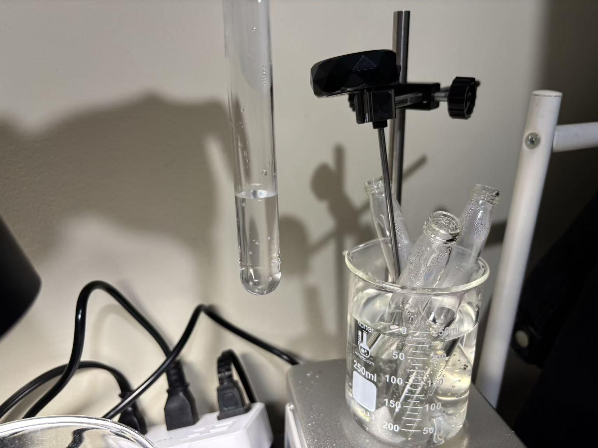

# Maillard Reaction in a Glucose-Glycine System

[Original PDF](report.pdf) · [All experiments](../)

*Original experiment report, reformatted for reading on GitHub.*

## Purpose

To observe the color changes during the water-heating bath of glucose and glycine, to explain the chemical reactions different composition with control group.

## Materials

| Sample | Glucose | Glycine | 0.1% (w/v) sodium carbonate solution | Final volume |
| --- | --- | --- | --- | --- |
| A: Mixed reaction sample | 1.60 g | 0.64 g | 2.00 mL | 8.00 mL |
| B: Glucose control | 1.60 g | None | 2.00 mL | 8.00 mL |
| C: Glycine control | None | 0.64 g | 2.00 mL | 8.00 mL |
| D: Mixture without sodium carbonate | 1.60 g | 0.64 g | None | 8.00 mL |

## Observations

Sample A shows a deep brown color; it is the darkest solution among them. Sample B shows a light yellow color in the solution. Third darkest among the solutions. (figure2) In sample C shows transparent and colorless among the solutions. In sample D, it is a dark brown color, after sample A.

| Figure 1 | Figure 2 | Figure 3 | Figure 4 |
| --- | --- | --- | --- |
|  |  |  |  |

## Chemical explanation

The Maillard reaction is a series of non-enzymatic reactions between glucose and the amino acid glycine. Heating facilitates the transformation of the intermediates into yellow and brown as the product of the reaction. Glucose is sometimes open-chain in water and has a CHO group at the end, which is reactive with the amino group of glycine and undergoes Amadori rearrangement; the reaction includes fragmentation and dehydration, causing the solution to absorb light and produce a dark color. The reason for the sample B is the color only result the degradation of sugar and sample C which lack of glucose cause the absence of the open chain tail CHO, where no reaction occurred. Sample D is that, even though there is no Sodium carbonate, the condition of the environment changed, causing less obvious color changes. Sodium carbonate makes the solution more alkaline: CO32–+ H2O • HCO3–+ OH–. This environment promotes sugar degradation and easier for the reaction to occur.

---

[View the original PDF](report.pdf) · [Back to all experiments](../)
