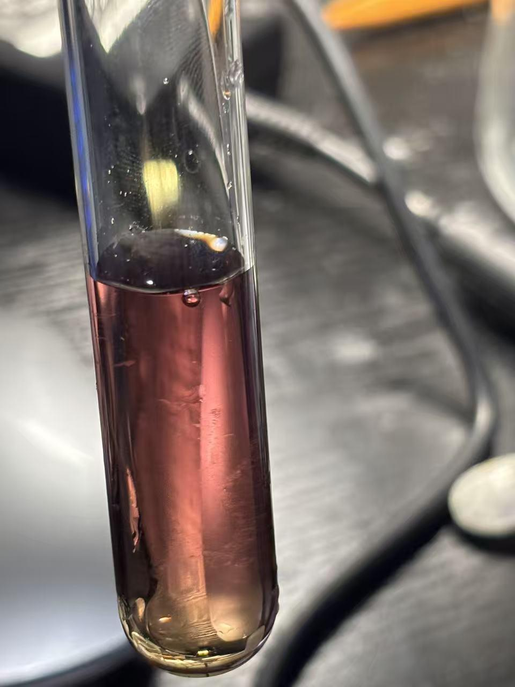
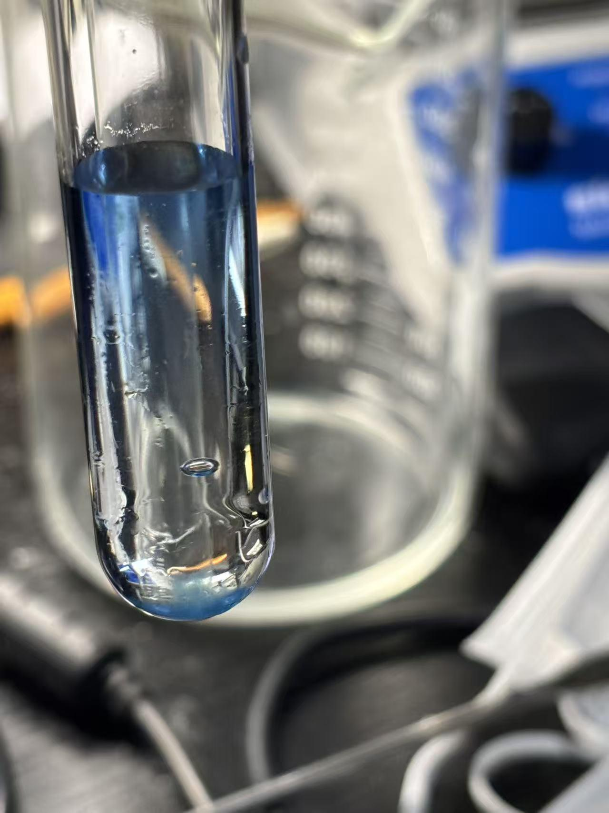
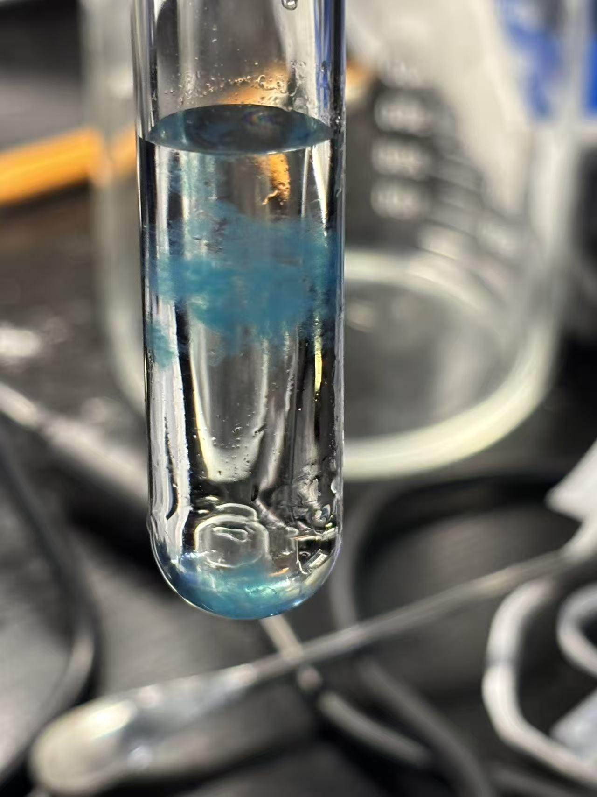
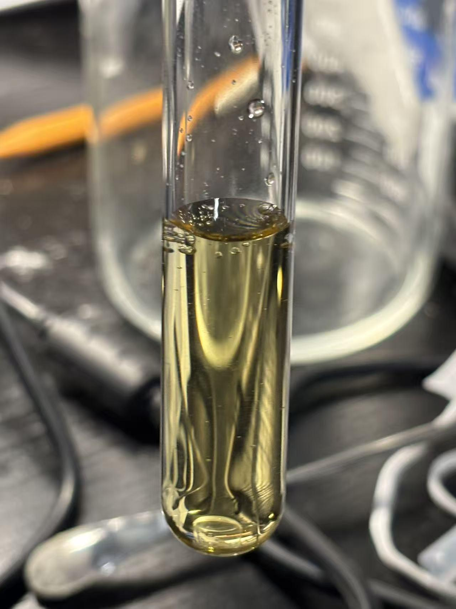

# Detection of Peptides Using the Biuret Test

[Original PDF](report.pdf) · [All experiments](../)

*Original experiment report, reformatted for reading on GitHub.*

## Purpose

To observe the color of the reaction between tryptone, glycine, and water with alkaline copper. To understand how the chemical reaction of peptide structure affects the copper.

## Materials

Tryptone, glycine, copper(II) sulfate solution, sodium hydroxide solution, distilled water, test tubes, a test-tube rack, pipettes

## Procedure

1. Add tryptone to A and D, Glycine to B, and distilled water to C
2. Add sodium hydroxide solution to each tube.
3. Add copper sulfate to A, B, and C. Add the same amount of water to D.

## Observations

| Tube | Composition | Photograph |
| --- | --- | --- |
| A | Tryptone, NaOH, copper sulfate |  |
| B | Glycine, NaOH, copper |  |
| C | Water, NaOH, copper |  |
| D | Tryptone, NaOH |  |

## Chemical explanation

In an alkaline environment, the N and H of the peptide bond lose protons, causing the original nitrogen atom to pair with Cu²⁺. Cu can form a coordinate bond with four nitrogen atoms, forming a chelate complex - there is a central ion that accepts the surrounding ligands' electrons to form a coordination bond (sharing two electrons). In this chelate complex, there will be two or more atoms and ligands connected. The deprotonated nitrogen atom becomes a strong ligand that affects the absorption of light. Tryptone itself has a yellow color. The color of A comes from the copper and peptide complex, B because it lacks a peptide bond, causes the combination of oxygen and copper forms copper glycinate, which is clear blue. C because there are no ligands, forms a precipitate. Therefore, the overall reaction comes from the coordination bonds between the surrounding ions and the central particle.

---

[View the original PDF](report.pdf) · [Back to all experiments](../)
