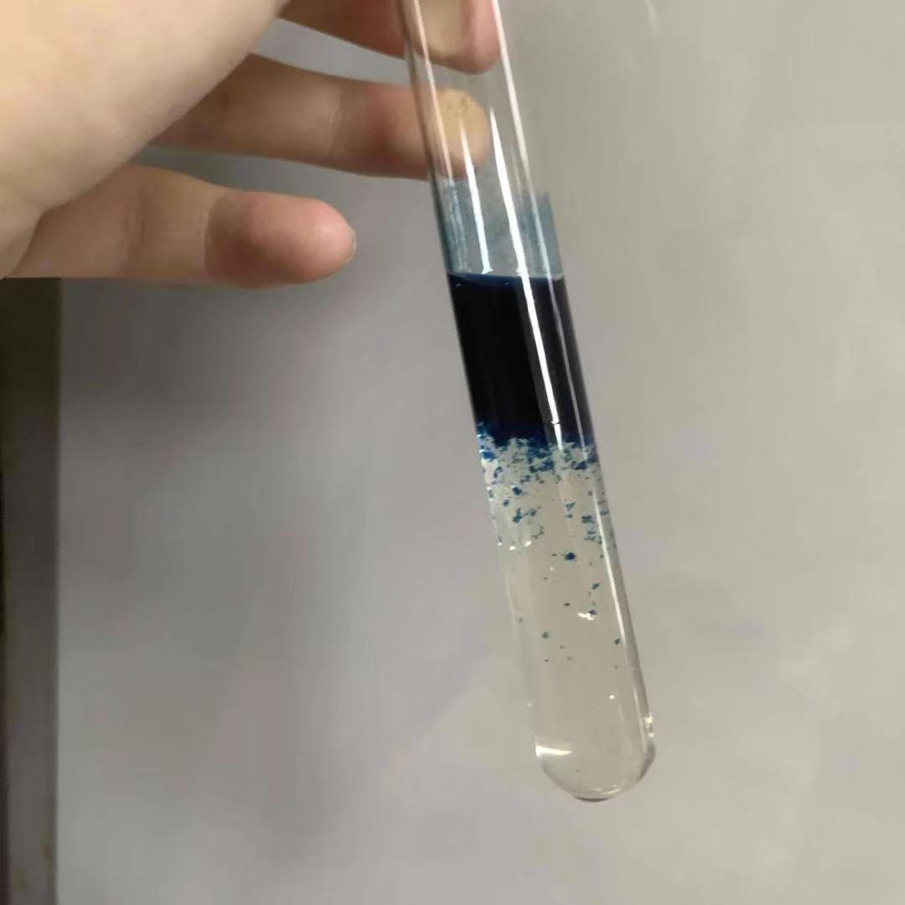

# Formation of Turnbull's Blue

[Original PDF](report.pdf) · [All experiments](../)

*Original experiment report, reformatted for reading on GitHub.*

## Purpose

To observe the reaction between iron sulfate and potassium ferricyanide and explain the chemical reaction, including the color and electron transfer.

## Materials

Iron sulfate solution, potassium ferricyanide solution

## Procedure

Combine the iron sulfate and potassium ferricyanide solutions in a test tube.

## Observations

Appears in different regions: dark blue at the top, small blue particles at the bottom.

## Chemical explanation

Potassium ferricyanide has a cyanide group that connects iron into a network; the electron transfer changes the iron oxidation states, producing Turnbull's blue, which contains both Fe2+ and Fe3+; the dark blue region forms because of intervalence charge transfer. As the light moves electrons around the neighboring iron, which absorbs red light, it turns blue.

---

[View the original PDF](report.pdf) · [Back to all experiments](../)
