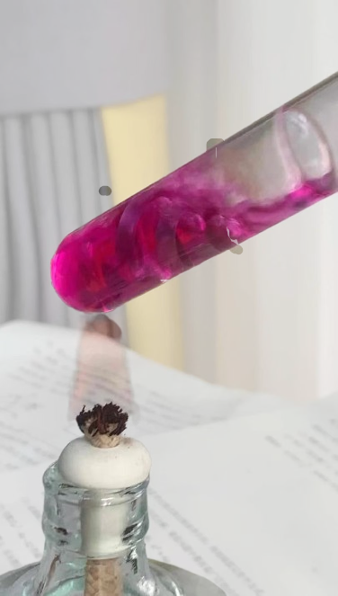

# Magnesium with Water Using Phenolphthalein

[Original PDF](report.pdf) · [All experiments](../)

*Original experiment report, reformatted for reading on GitHub.*

## Purpose

To observe how magnesium reacts with water and use phenolphthalein to determine the change in alkalinity.

## Materials

Magnesium, water, phenolphthalein solution. Alcohol lamp

## Procedure

Magnesium is added to contact with water containing phenolphthalein, which appears in color and gas formation.

## Observations

During heating, the solution appeared pink, magnesium ribbon still visible inside the tube.

## Chemical explanation

Magnesium reacts with water in an oxidation-reduction reaction. It loses electrons and becomes Mg2+, which water accepts the electrons. In the process, the transfer of electrons produces hydrogen gas and hydroxide ions that change the solution alkaline, this cause phenolphthalein to lose protons changed the structure. The heating speed up the reaction.

---

[View the original PDF](report.pdf) · [Back to all experiments](../)
