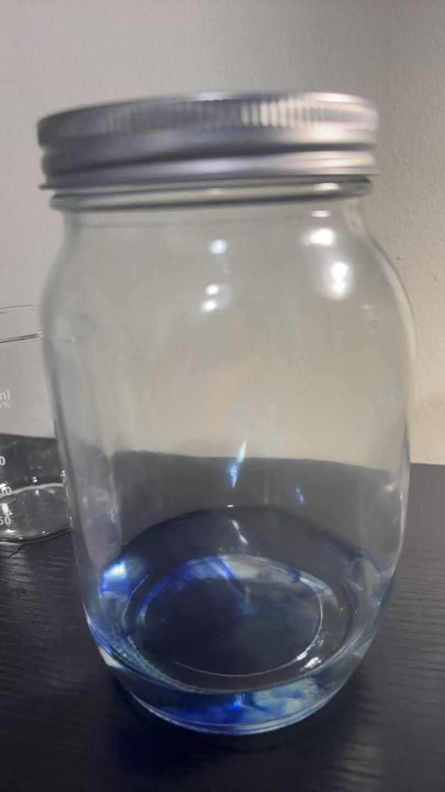
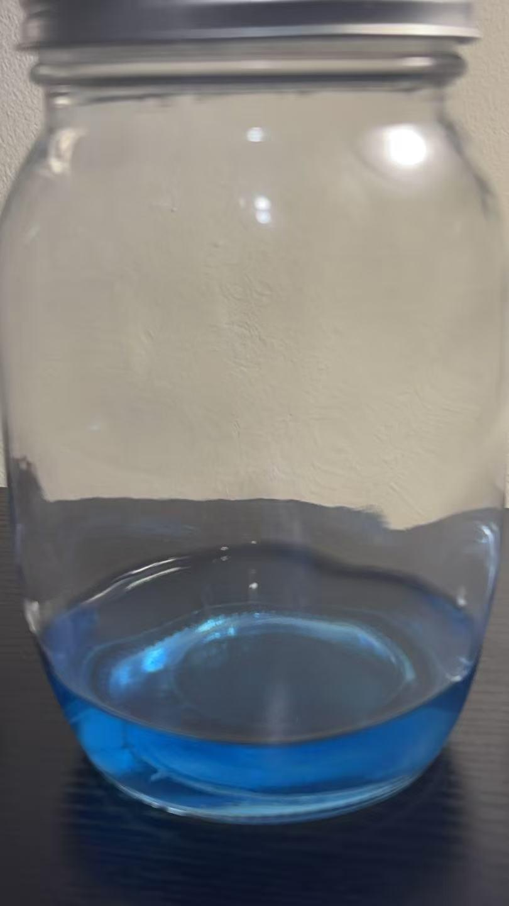
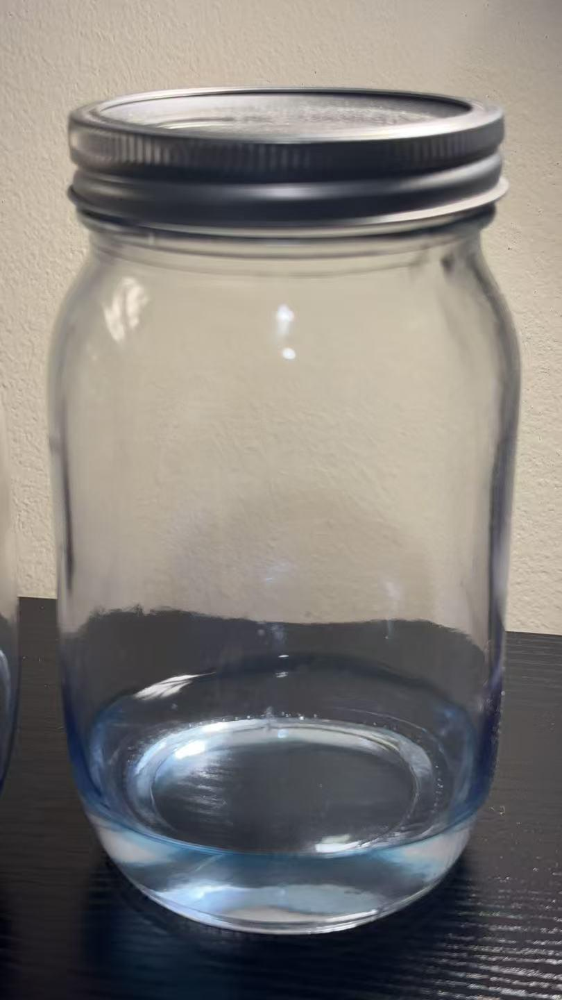

# Reduction of Methylene Blue by Glucose

[Original PDF](report.pdf) · [All experiments](../)

*Original experiment report, reformatted for reading on GitHub.*

## Purpose

To observe the repeated oxidation and reduction of methylene blue and explain the chemical reactions of glucose and oxygen.

## Materials

Glucose, methylene blue solution, sodium hydroxide, distilled water.

## Procedure

1. Combine glucose, sodium hydroxide solution, and water
2. Add Methylene blue solution
3. Cap the bottle and wait for the liquid to return to a colorless state.
4. Shake the bottle and observe the change in color.

## Observations

| Beginning | Middle | End |
| --- | --- | --- |
|  |  |  |

**End observation recorded in the report:** It starts to fade out gradually (10 min).

## Chemical explanation

In an alkaline solution, glucose transfers electrons to methylene blue(C16H18N3S +H2O +2e – C16H19N3S+OH), reducing it to a colorless state. Shaking dissolves oxygen from the air, which reoxidizes it and restores the blue color (C6H12O6 +3OH– C6H11O7 +2H₂O + 2e). Methylene blue acts as the redox mediator, transferring electrons from glucose to oxygen.

---

[View the original PDF](report.pdf) · [Back to all experiments](../)
