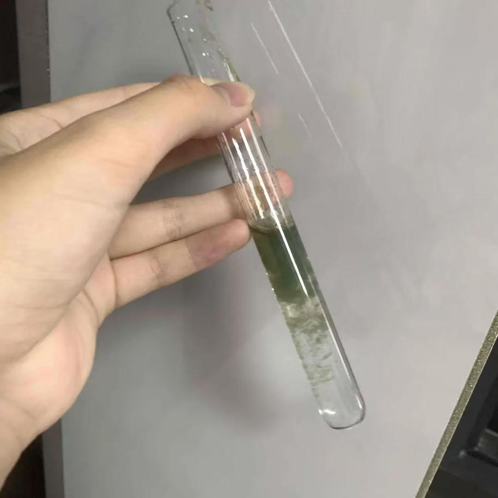

# Reduction of Copper(II) Hydroxide by Glucose

[Original PDF](report.pdf) · [All experiments](../)

*Original experiment report, reformatted for reading on GitHub.*

## Purpose

To observe the oxidation-reduction reaction and color of the reducing ability of glucose in copper.

## Materials

Glucose, copper II sulfate, sodium hydroxide, water

## Procedure

1. Combine copper II sulfate and sodium hydroxide.
2. Add glucose

## Observations

It appears darker green at the top of the test tube, with cloudy particles in the middle dividing the clear and dark regions.

## Chemical explanation

The glucose is commonly found in cyclic hemiacetal form in water, and only a small portion exists in an open-chain structure. In this rare case, the CHO is exposed. If it is consumed, the chemical bond equilibrium will shift and move along the open chain. In the Benedict reagent, Cu2 will be encapsulated by citric acid to form a soluble complex - (the charged center is a metal particle and the nearby molecules are arranged with electrons) forming coordination bonds. In an alkaline environment, CuOH2 will not form. When the aldehyde group is oxidized, it converts to a carboxylate, and the overall oxidation state of C1 rises. Cu2+ is reduced (KPU, Organic Chemistry). This insoluble precipitate will cause a color change as the sugar content increases. In this sample, Th below sugar content indicate the lower sugar had been put in.

---

[View the original PDF](report.pdf) · [Back to all experiments](../)
