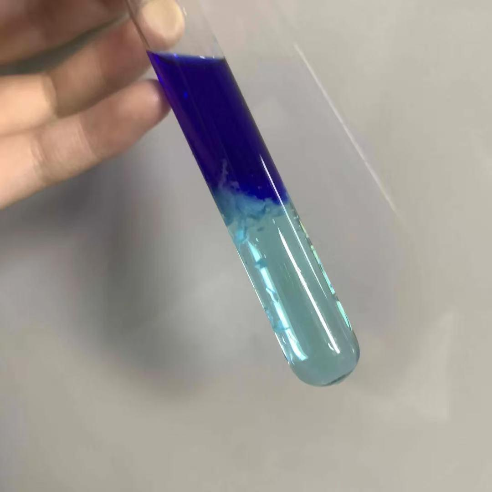

# Copper(II) and Ammonia Complex Formation

[Original PDF](report.pdf) · [All experiments](../)

*Original experiment report, reformatted for reading on GitHub.*

## Purpose

To observe the reaction between ammonia and copper (II) nitrate and explain the chemical reaction between ammonia as a base that changes the color of copper precipitation.

## Materials

Copper (II) nitrate, ammonia solution

## Procedure

1. Add 0.2 g copper (II) nitrate
2. 10ml distilled water
3. ~8 mL aqueous ammonia

## Observations

A deep blue appears at the top region of the liquid, the pale blue remains at the bottom of the test tube, with solid material at the boundary.

## Chemical explanation

Ammonia is a weak base that produces hydroxide to form the pale blue color of copper (II) hydroxide. When there is enough ammonia, there will be more copper bound to ammonia, which causes the redissolving of the precipitate. The change in the coordination environment affects the light it absorbs; therefore, the solution turns blue at different levels. (Cu²⁺ + 2OH⁻ → Cu(OH)₂) Because the density of the ammonia solution is relatively low, it will form a layer that floats on the upper layer, creating a situation where the concentrations alternate. In the middle layer, there is less ammonia and the weak base can only allow a small amount of ionization, allowing OH and Cu2 to combine. At the top layer, due to the excessive ammonia, NH3 can directly bind with Cu2 to form a dark blue phenomenon.

---

[View the original PDF](report.pdf) · [Back to all experiments](../)
