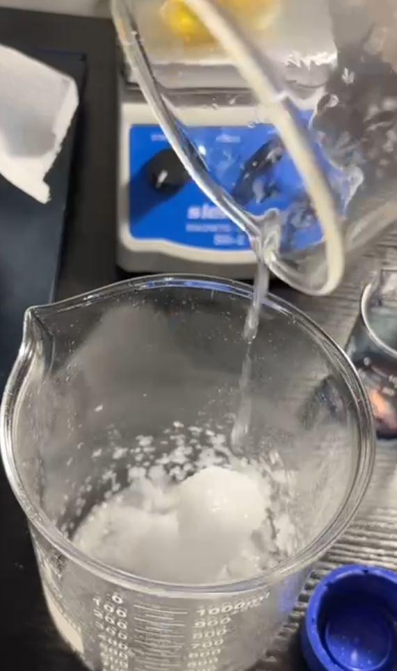
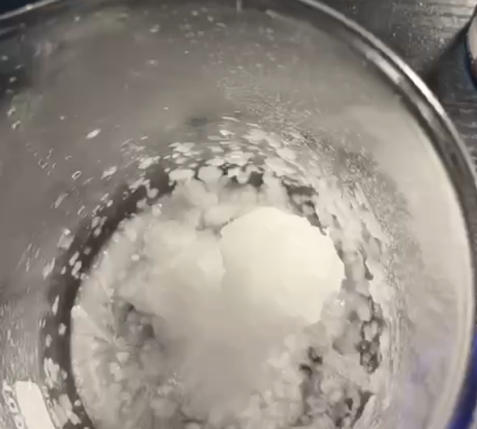

# Crystallization of Sodium Acetate - Hot Ice

[Original PDF](report.pdf) · [All experiments](../)

*Original experiment report, reformatted for reading on GitHub.*

## Purpose

To observe the reaction of supersaturated sodium acetate crystallization under the given conditions and understand the chemistry concept of triggering solidification of the liquid.

## Materials

Sodium acetate trihydrate, distilled water, sodium acetate seed

## Procedure

1. 1g of sodium acetate trihydrate crystal reserved as seed.
2. Add 125g sodium acetate trihydrate and 12.5mL of distilled water.
3. It was heated to 80 degree for 15m and stirred until there is no more solid at the bottom.
4. Place it on the table wait for cooling to room temperature ~ 22
5. Place the seed at center of new container,
6. The cooled solution is then pour on the crystal, observe the reaction.

## Observations

White non-transparent crystal is formed as the liquid poured on the seed.

## Chemical explanation

Once the sodium acetate trihydrate is heated, the solubility increases, in the experiment it completely dissolved at 80 degree form the solution, during the cooling it shouldn't be any disturbance because it may crystallize, due to it is supersaturated, it is likely crystallize or form solid particles, but in this case it is metastable which in a rest state. Nucleation reactions are necessary because we need a first seed particle cluster to ensure the crystallization of a liquid. When particles are added to the lattice, they release energy, causing each cluster to form a solid surface. During this process, a significant amount of energy is lost, and the liquid re-enters it. However, only clusters past a certain size can grow steadily and crystallize. The crystallization process and preparation require a clean container because the nucleation of sodium acetate requires a lot of energy. If there are residues in the container, it will disrupt this stability. The poured solution will blend with the existing crystals and form new crystals. During this process, it releases the latent heat energy from the supercooled liquid. The contact surfaces of the introduced liquids are different, and they grow randomly to form the final product.

---

[View the original PDF](report.pdf) · [Back to all experiments](../)
