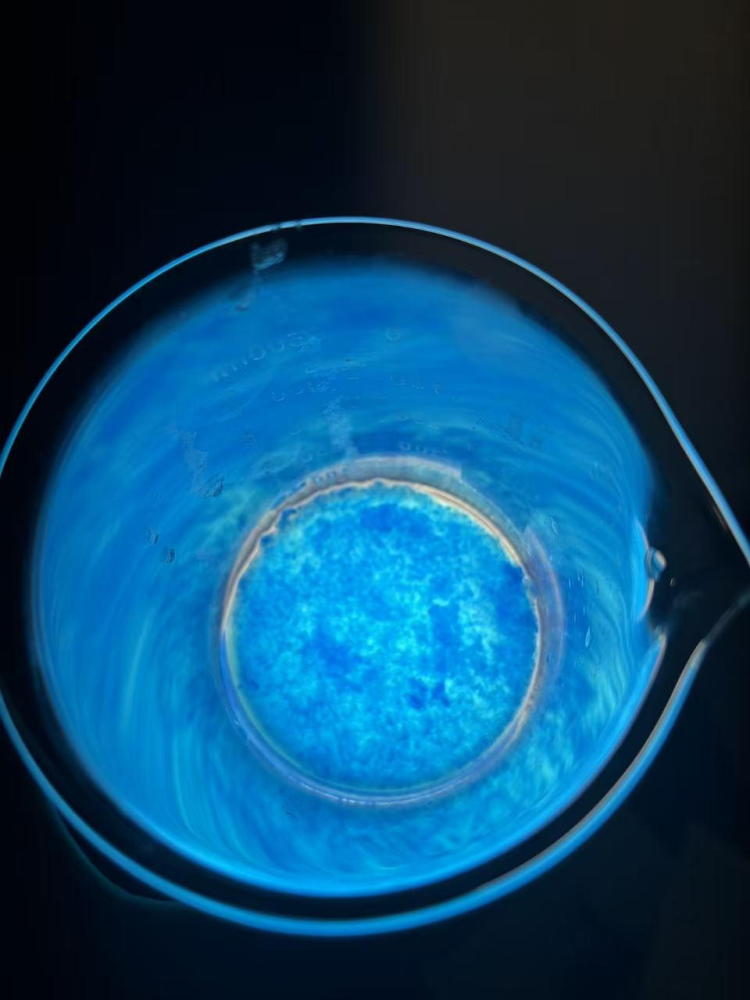

# Chemistry Portfolio

I independently research, plan, and carry out chemistry experiments. I document the methods and results in written reports, and use photographs and videos to record changes in color, light, and crystal growth.

**49 experiment entries · 10 written reports · 7 video recordings**

[**Browse all 49 experiments**](experiments/README.md) · [Combined report (PDF)](source-documents/chemistry-project-series-report.pdf) · [Video gallery](https://jw3422951-ops.github.io/chemistry-portfolio/)

## Featured experiment

### [Copper Sulfate Recrystallization and Crystal Growth](experiments/11-copper-sulfate-crystal-growth)

I extended the recrystallization experiment into a 28-day crystal growth study. The record includes the initial filtration, the adjustment I made on Day 3, and the crystals I photographed at the end.

*Beaker close-up from the initial recrystallization experiment.*

## Explore the collection

- [01–10 · Experiments with written reports](experiments/README.md#experiment-reports)
- [11 · 28-day crystal growth](experiments/11-copper-sulfate-crystal-growth)
- [12–49 · Photo and video records](experiments/README.md#photo-and-video-records)

[Return to my GitHub profile](https://github.com/jw3422951-ops)
