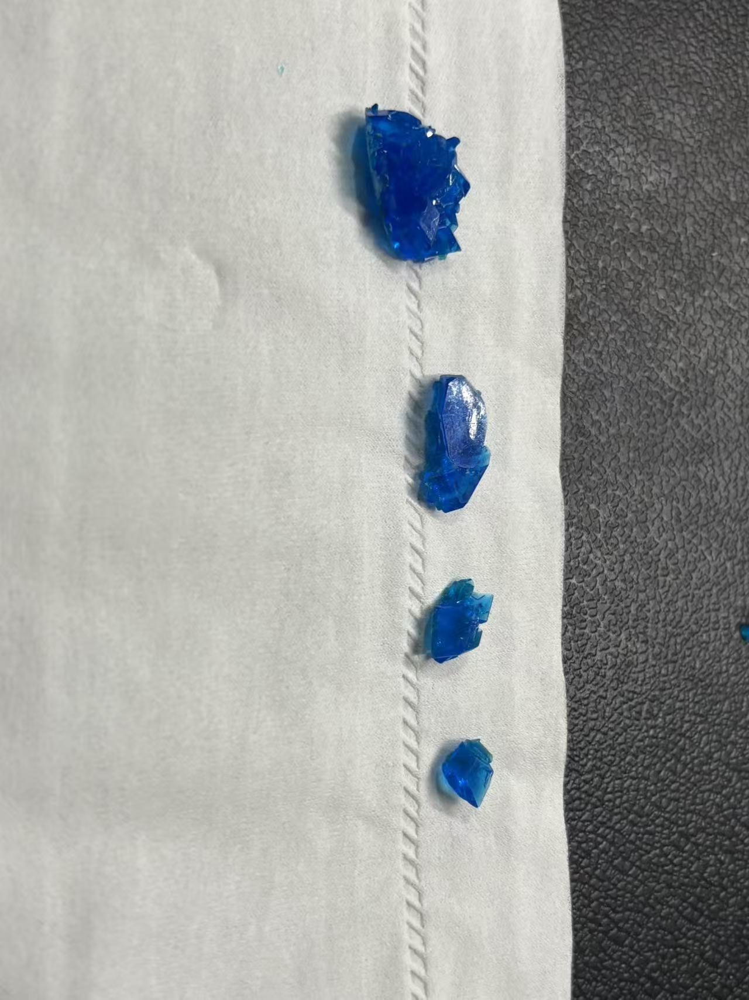
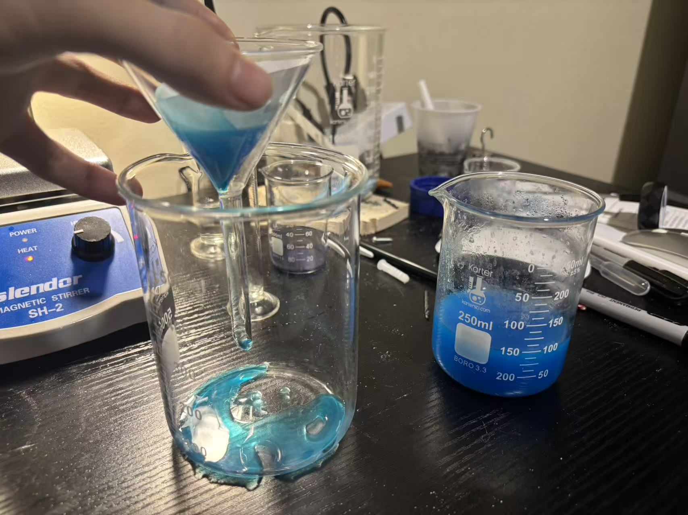
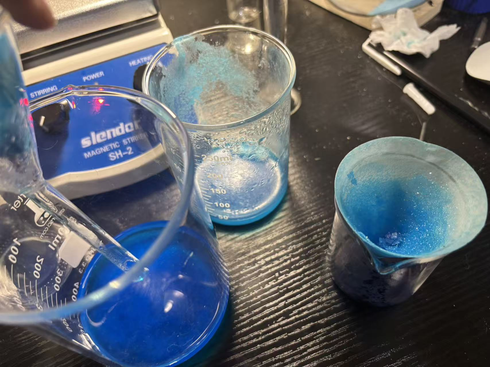
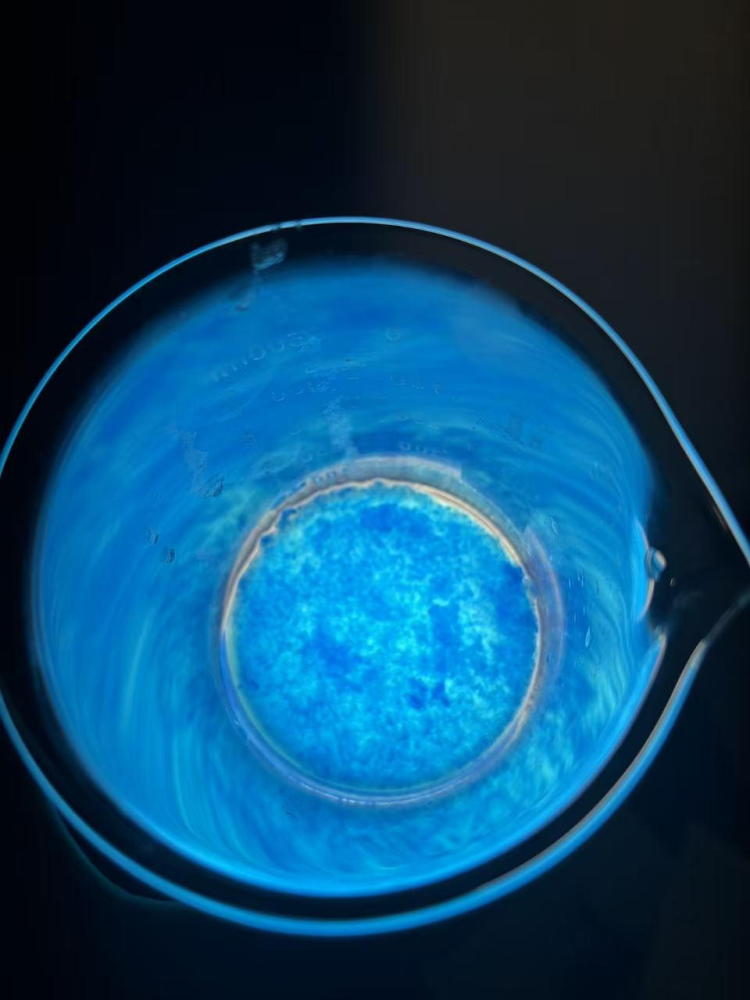

# Copper Sulfate Recrystallization and Crystal Growth

**Self-directed chemistry study · Recrystallization · 28-day cultivation result**

I began with a copper sulfate recrystallization experiment and continued cultivating the material with the aim of growing larger crystals. This entry brings together three photographs from the initial experiment and a later result photograph taken after 28 days of cultivation.

## Result after 28 days

*Four main blue crystals photographed after 28 days of cultivation.*

The photograph records the recovered crystals' visible faces, edges, and differences in shape. No measurements of crystal dimensions, mass, or purity are included with this photographic record.

## What I wanted to investigate

I wanted to extend the work beyond the initial recrystallization stage and obtain larger crystals through continued growth. The later photograph documents the outcome of that continuation.

## Adjustment and follow-up observations

On the third day, the particles I had placed in the solution had dissolved. I then prepared a supersaturated solution to continue the crystal-growing experiment.

I next checked the sample about ten days later. After that, I observed it every three days and noticed that the crystals were gradually growing. The day-28 photograph records the later result of this continued cultivation.

## My contribution

I researched the relevant concepts, planned the experiment, and carried out the experimental work myself. This was part of my long-term, self-directed chemistry learning, undertaken in my own workspace.

## Photographs from the initial experiment

These three photographs belong to the same experiment. They document different aspects of the work; their arrangement here is by subject.

### Filtration

*Filtration of the blue mixture into a receiving beaker.*

### Collected material

*Blue solid material collected in an evaporating dish alongside the remaining solution.*

### Beaker detail

*A close-up of the blue material collected at the bottom of the beaker.*

---

[Back to the experiment index](../README.md) · [GitHub profile](https://github.com/jw3422951-ops)
